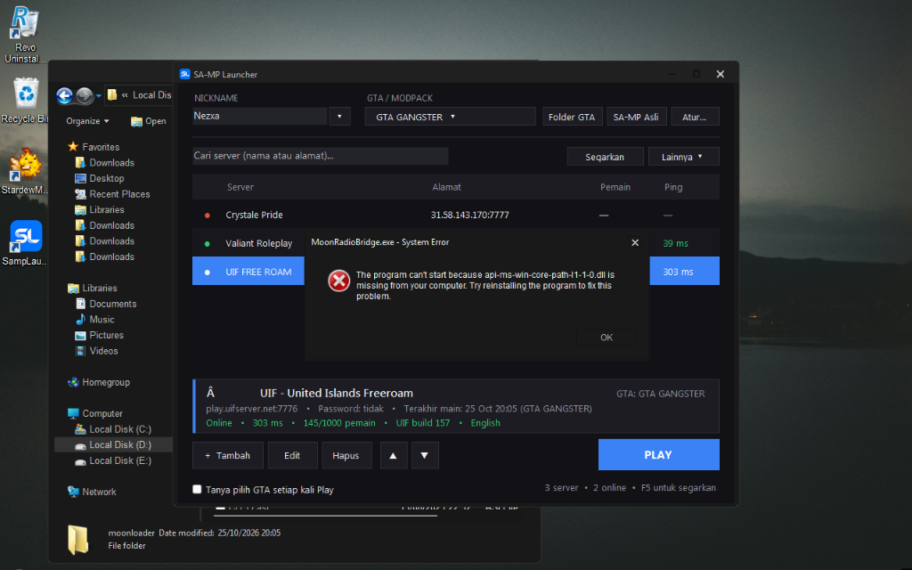
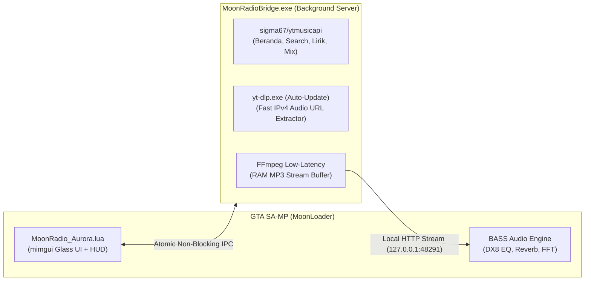

<div align="center">

# 🎵 MoonRadio Aurora v4.0 — YouTube Music Edition
**In-Game YouTube Music Streaming, Studio Audio FX, Synced Karaoke Lyrics & Glassmorphism HUD for GTA SA-MP**

[](#)
[](#)
[](https://github.com/sigma67/ytmusicapi)
[](#kompatibilitas-windows-7--windows-1011)
[](LICENSE)

<br/>



*Streaming jutaan lagu langsung dari **YouTube Music** di dalam GTA SA-MP tanpa perlu mengunduh/menyimpan file MP3 lokal dan **tanpa perlu menginstal Python** (Plug-and-Play).*

</div>

---

## ✨ Fitur Utama

- **🎧 Streaming Langsung YouTube Music (Zero Local MP3)**
  Cari dan putar lagu, video musik, remix, cover, maupun playlist resmi YouTube Music secara *real-time* di dalam game.
- **🏠 Beranda Pintar & Rekomendasi Asli (`ytmusicapi`)**
  Menampilkan rak lagu *Trending*, *Rilisan Baru*, *Playlist Kurasi*, saran kata kunci (*live search suggestions*), serta **Radio Pintar Untukmu** yang menyesuaikan rekomendasi berdasarkan riwayat lagu yang baru kamu putar.
- **⚡ Low-Latency & Optimasi Laptop (Anti-Lag)**
  Arsitektur *Non-Blocking Atomic IPC* + *Adaptive Polling* (0 operasi baca/tulis disk saat idle), ekstraksi cepat IPv4 (`-4`), *low-latency FFmpeg RAM buffer* (~0.2 detik inisiasi), serta *pre-resolve* otomatis lagu berikutnya di antrean.
- **🖼️ Pilihan Tampilan Cover Art & Vinyl Disc**
  Pilih gaya tampilan sesuai selera: **Cover Art Langsung (Gaya YouTube Music)**, **Vinyl Disc Berputar**, atau kombinasi keduanya (klik kanan pada gambar cover di Player Bar atau ketik `/rcover`).
- **🎤 Lirik Tersinkronisasi (`.LRC`) & Floating Karaoke HUD**
  Mengambil lirik ber-timestamp otomatis dari YouTube Music & LRCLIB. Klik baris lirik untuk melompat (*seek*) ke bagian lagu tersebut, atau aktifkan **Karaoke Layar** (`/rkaraoke`) saat menyetir.
- **🎛️ Studio Audio FX (DX8 Real-Time DSP)**
  Dilengkapi **3-Band Parametric Equalizer** (Bass, Mid, Treble), **Speed & Pitch Control** (`50%–150%` untuk efek *Nightcore* atau *Slowed + Reverb*), **DX8 Concert Reverb**, **Stereo Panning**, **In-Car Stereo Boost**, dan 2 slot memori kustom.
- **🏝️ 4 Gaya Mini Player HUD Interaktif & Bebas Geser**
  Pilihan gaya *Dynamic Island*, *Glass Deck*, *Vinyl Turntable*, dan *Minimal Ribbon*. Geser posisi dan atur ukurannya secara bebas di layar dengan `/rminipos`.
- **🔄 Auto-Update `yt-dlp` Mandiri**
  `MoonRadioBridge.exe` mengunduh dan memperbarui `yt-dlp.exe` secara otomatis dari GitHub Releases di latar belakang, sehingga mod tidak akan kedaluwarsa saat YouTube memperbarui sistemnya.

---

## 🧩 Arsitektur Sistem



---

## 🚀 Cara Instalasi (Untuk Pemain — Plug & Play)

Pemain **tidak perlu** menginstal Python atau library tambahan apa pun:

1. Pastikan GTA SA-MP kamu sudah terpasang **MoonLoader** beserta library **`mimgui`** (`moonloader/lib/mimgui`).
2. Unduh paket rilis terbaru di halaman **[GitHub Releases](../../releases)**:
   - 💻 **`MoonRadio_Win10_11.zip`** — untuk pengguna **Windows 8 / 10 / 11 (64-bit)**.
   - 🪟 **`MoonRadio_Win7.zip`** — khusus pengguna **Windows 7 SP1** (juga kompatibel di Windows 10/11).
3. Ekstrak dan salin folder **`moonloader/`** ke dalam direktori utama GTA San Andreas kamu:
   ```text
   GTA San Andreas/
   └─ moonloader/
      ├─ MoonRadio_Aurora.lua
      └─ radio/
         ├─ MoonRadioBridge.exe
         └─ bin/
            └─ ffmpeg.exe
   ```
4. Masuk ke dalam game GTA SA-MP:
   - Ketik **`/radio`** (atau tekan tombol **`F10`**) untuk membuka jendela utama MoonRadio.
   - Atau langsung ketik **`/rplay [judul lagu]`** untuk memutar lagu tanpa membuka menu!
5. *(Khusus pemakaian pertama kali)*: Tunggu ±10–25 detik saat `MoonRadioBridge.exe` mengunduh `yt-dlp.exe` resmi secara otomatis di latar belakang.

> [!NOTE]
> `MoonRadioBridge.exe` berjalan otomatis secara tersembunyi (*background*) saat mod aktif dan **menutup dirinya sendiri secara otomatis** ±1–2 menit setelah kamu keluar dari GTA SA-MP.

---

## 🎮 Daftar Perintah In-Game (SA-MP Commands)

| Perintah | Fungsi |
| :--- | :--- |
| **`/radio`** (atau `F10`) | Membuka / menutup jendela utama MoonRadio Aurora |
| **`/rplay [judul / artis]`** | Mencari & langsung memutar lagu dari YouTube Music tanpa membuka menu |
| **`/ryt [judul / artis]`** | Alias cepat untuk `/rplay` |
| **`/rcari [kata kunci]`** | Membuka menu pencarian YouTube Music dan menampilkan daftar hasil |
| **`/rcover`** | Mengganti gaya gambar Player (*Cover Art Langsung* / *Vinyl Berputar*) |
| **`/rcompact`** | Beralih ke mode *Compact Glass Deck* (jendela mini melayang) |
| **`/rpause`** | Putar / Jeda (*Play / Pause*) lagu saat ini |
| **`/rnext`** / **`/rprev`** | Lagu berikutnya / lagu sebelumnya di antrean |
| **`/rvol [0-100]`** | Mengatur volume musik (`0%` – `100%`) |
| **`/rkaraoke`** | Menyalakan / mematikan *Floating Karaoke Lyrics* di layar game |
| **`/rlyrics`** | Membuka tab Lirik & Karaoke |
| **`/rmini`** | Menyalakan / mematikan *Mini Player HUD* |
| **`/rminipos`** | Membuka *Editor Tata Letak HUD Bebas* (geser & ubah ukuran Mini HUD / Karaoke) |
| **`/rministyle`** | Mengganti tema visual *Mini Player HUD* (*Dynamic Island*, *Glass Deck*, *Vinyl*, *Ribbon*) |
| **`/rfx [0-7]`** | Mengganti preset *Studio Audio FX* (*Normal*, *Bass Boost*, *Vocal*, *Nightcore*, *Slowed+Reverb*, *Lo-Fi*, *Hall*) |
| **`/rspeed [50-150]`** | Mengatur kecepatan & tinggi nada lagu (`100` = normal) |
| **`/rglass [55-98]`** | Mengatur tingkat transparansi kaca (*Glass Frost Opacity*) |
| **`/rsmart`** | Menyalakan / mematikan *Smart Shuffle* (acak pintar anti-tabrakan genre/mood) |
| **`/rautomix`** | Menyalakan / mematikan *AutoPlay YouTube Music Radio* saat antrean habis |
| **`/rfav`** | Menambahkan / menghapus lagu yang sedang diputar dari daftar Favorit |
| **`/rsleep [menit]`** | Memasang *Sleep Timer* otomatis dengan *fade-out* halus |

---

## 🪟 Kompatibilitas Windows 7 & Windows 10/11

Proyek ini menyediakan dua varian build agar dapat berjalan di seluruh versi Windows:

| Fitur / Komponen | Paket Standar (`MoonRadio`) | Paket Legacy (`MoonRadio_Win7`) |
| :--- | :--- | :--- |
| **Target OS** | Windows 8.1, 10, 11 (64-bit) | Windows 7 SP1 (32/64-bit) & Win 10/11 |
| **Runtime Bundled** | Python 3.9+ (64-bit) | Python 3.8.10 (32-bit, bebas error `api-ms-win-core-path`) |
| **Binary `yt-dlp`** | Rilis resmi `yt-dlp/yt-dlp` (`yt-dlp.exe`) | Build Win7 `nicolaasjan/yt-dlp` (`yt-dlp_x86_win7.exe`) |
| **Rekomendasi `ffmpeg.exe`** | FFmpeg 7.x / 8.x Release Essentials | FFmpeg 7.0.2 / Builds Win7 kompatibel |

---

## 🛠️ Panduan Build dari Source (Untuk Developer / Modder)

Jika kamu ingin memodifikasi kode sumber dan mem-build ulang `MoonRadioBridge.exe` sendiri:

### Struktur Direktori Repository
```text
MoonRadio_Package/
├─ assets/
│  └─ preview.png                 # Screenshot tampilan in-game
├─ packaging/
│  └─ ytmusicapi_win7_compat.py   # Shim kompatibilitas Python 3.8 untuk ytmusicapi terbaru
├─ src/
│  ├─ MoonRadio_Aurora.lua        # Script utama MoonLoader (mimgui UI + BASS Audio DSP)
│  ├─ music_player.py             # Server Bridge YouTube Music, HTTP RAM Streamer & LRC Engine
│  └─ toolchain.py                # Auto-updater yt-dlp, Fast IPv4 Extractor & FFmpeg locator
├─ build.bat                      # Skrip build paket Windows 10/11 (dist/MoonRadio)
├─ build_win7.bat                 # Skrip build paket Windows 7 (dist/MoonRadio_Win7)
├─ pack_releases.bat              # Skrip pembuat file .zip siap unggah ke GitHub Releases
├─ requirements-build.txt         # Dependensi build standar
└─ requirements-build-win7.txt    # Dependensi build khusus Windows 7
```

### Cara Build Paket
1. **Build Paket Windows 10/11**:
   ```bat
   build.bat
   ```
   Hasil build akan tersedia di folder `dist\MoonRadio\`.
2. **Build Paket Windows 7** *(membutuhkan Python 3.8 32-bit)*:
   ```bat
   build_win7.bat
   ```
   Hasil build akan tersedia di folder `dist\MoonRadio_Win7\`.
3. **Tambahkan `ffmpeg.exe` & Buat File `.zip` Rilis**:
   - Letakkan `ffmpeg.exe` ke dalam `dist\MoonRadio\moonloader\radio\bin\` dan `dist\MoonRadio_Win7\moonloader\radio\bin\`.
   - Jalankan `pack_releases.bat` untuk menghasilkan file `.zip` siap rilis di dalam folder `releases\`.

---

## 🙏 Kredit & Penghargaan

- **Author Mod**: **Nezxa**
- **[sigma67/ytmusicapi](https://github.com/sigma67/ytmusicapi)** — API klien YouTube Music untuk pencarian, beranda, rekomendasi radio, dan lirik ber-timestamp.
- **[yt-dlp](https://github.com/yt-dlp/yt-dlp)** & **[nicolaasjan/yt-dlp](https://github.com/nicolaasjan/yt-dlp)** — Ekstraktor stream audio dengan dukungan auto-update.
- **[LRCLIB](https://lrclib.net/)** — Database lirik sinkronisasi `.LRC` komunitas.
- **[FFmpeg](https://ffmpeg.org/)** & **Un4seen BASS** — Transcoding audio real-time dan pemrosesan efek DSP di dalam GTA SA-MP.

---

## 📄 Lisensi

Didistribusikan di bawah lisensi **MIT License**. Lihat file [`LICENSE`](LICENSE) untuk informasi selengkapnya.
